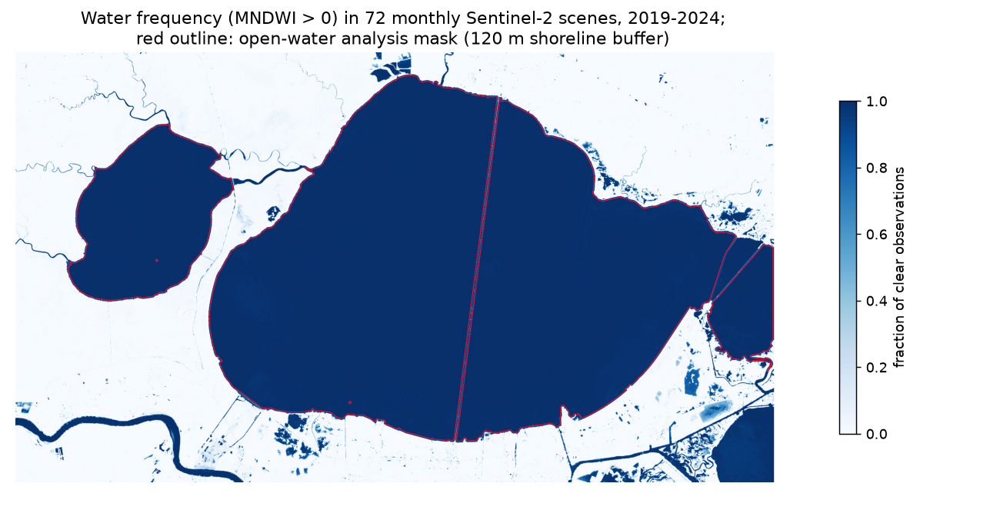
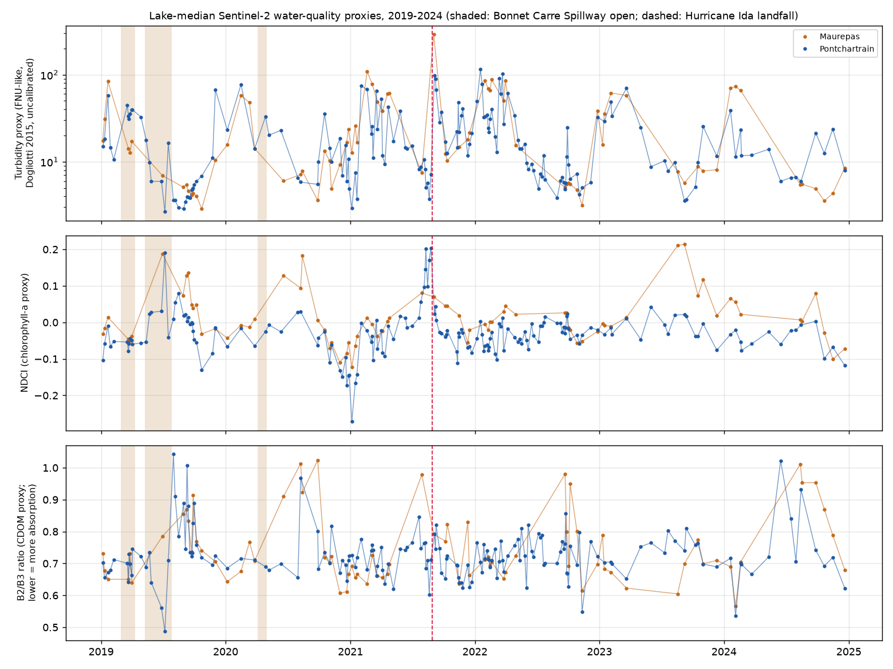
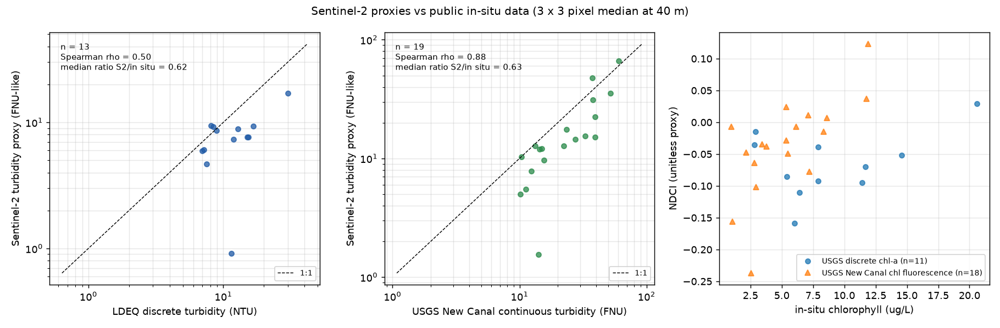
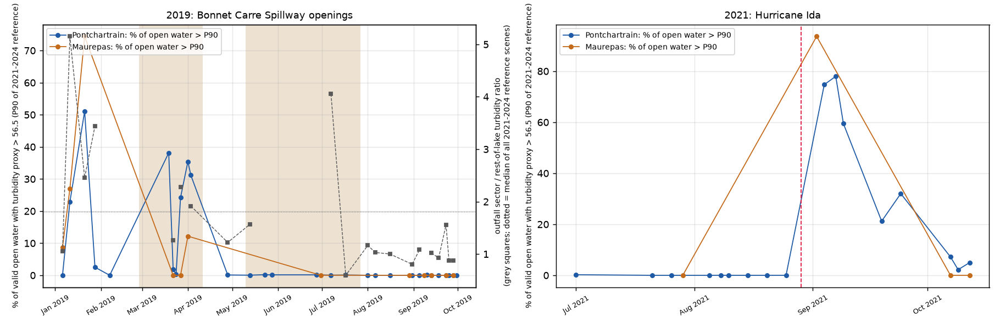
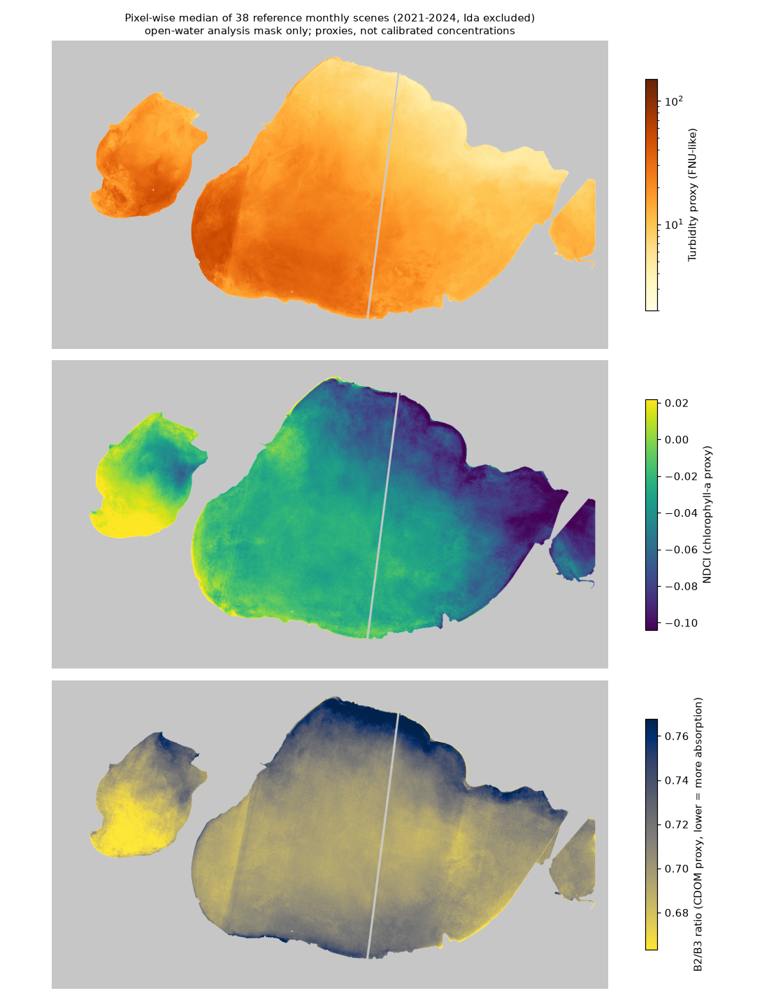
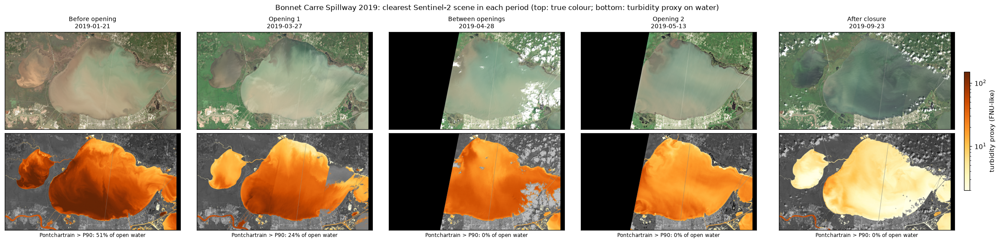
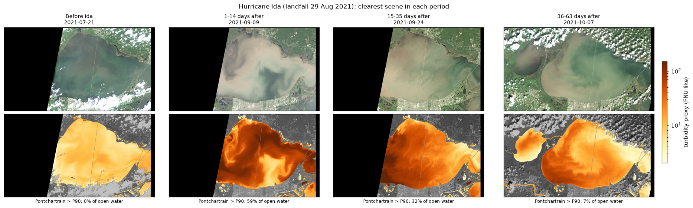
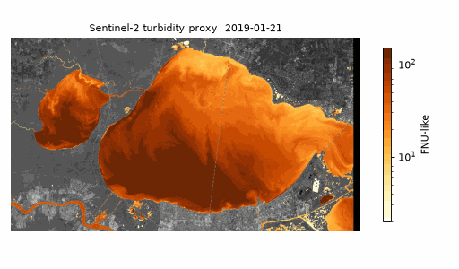

# Lake Pontchartrain and Lake Maurepas: Sentinel-2 water-quality proxies, 2019-2024

**Author:** Anamika Dristi, Ph.D.

This repository maps water-quality proxies for Lake Pontchartrain and Lake Maurepas, Louisiana, from Sentinel-2 Level-2A imagery for 2019 to 2024. Imagery comes from the anonymous Microsoft Planetary Computer STAC. Only the lake window of each cloud-optimized GeoTIFF is streamed at 40 m, so no full tiles are downloaded. The workflow builds an open-water mask from MNDWI, masks clouds with the Scene Classification Layer (SCL), and computes three proxies: a turbidity proxy (Dogliotti et al. 2015 algorithm), NDCI as a chlorophyll-a proxy, and a B2/B3 band ratio as a CDOM proxy. The turbidity proxy is compared with public in-situ turbidity from USGS and the Louisiana Department of Environmental Quality (LDEQ). The proxies are then used to look at the 2019 Bonnet Carre Spillway openings and at Hurricane Ida (August 2021). The run used 239 Sentinel-2 acquisitions: the clearest scene in each of the 72 months, plus extra scenes around the two events and the in-situ sampling dates.

**All three indices are relative proxies, not calibrated concentrations.** The turbidity values are "FNU-like" numbers from a published generic algorithm. They have not been tuned to these lakes.

This is an independent analysis of public data. It is separate from my LSU dissertation datasets and does not use or reproduce any of my LSU field data.

## Why it matters

Lake Pontchartrain and Lake Maurepas receive river, spillway and stormwater inputs. They support fisheries, recreation and coastal restoration programs. Satellite proxies can give agencies a lake-wide view between field cruises. This project uses skills that environmental scientist, environmental health, and GIS and remote sensing roles in Louisiana and Texas ask for:
- cloud-native raster processing;
- water masking;
- honest validation against agency monitoring data;
- event analysis;
- GIS-ready outputs (GeoTIFF, GeoJSON).

## Data sources (all public, accessed 23 October 2026)

| Data | Source and ID | Records used |
|---|---|---|
| Sentinel-2 L2A surface reflectance, bands B02, B03, B04, B05, B8A, B11, SCL | Microsoft Planetary Computer STAC, collection `sentinel-2-l2a`, MGRS tile 15RYP, relative orbits 126 and 83. Accessed anonymously, URLs signed with the `planetary-computer` package. https://planetarycomputer.microsoft.com/dataset/sentinel-2-l2a | 1,004 STAC items, giving 841 unique acquisitions (2019-01-01 to 2024-12-30). 602 were cloud-scored and 239 were processed. |
| Continuous turbidity (parameter 63680, FNU) and chlorophyll fluorescence (32316, ug/L) | USGS site 300138090064700, New Canal Lighthouse at New Orleans, LA. USGS Water Data OGC API: https://api.waterdata.usgs.gov/ogcapi/v0/collections/continuous | 30,842 turbidity and 30,046 fluorescence values at 30-minute steps (2020-12-01 to 2022-10-11) |
| Discrete turbidity (NTU) | Water Quality Portal, mostly LDEQ ambient monitoring (`LADEQWPD_WQX`). Stations named "Lake Pontchartrain ..." or "Lake Maurepas ...". https://www.waterqualitydata.us | 201 results, 35 stations, 2019-01-08 to 2024-10-15 |
| Discrete chlorophyll-a (ug/L) | Water Quality Portal, USGS Louisiana (`USGS-LA`), causeway stations | 81 results, 4 stations, 2019-02-27 to 2021-12-07 |
| Event dates | Bonnet Carre Spillway 2019: open 27 Feb to 11 Apr and 10 May to 27 Jul. 2020: open 3 Apr to 1 May. Hurricane Ida landfall: 29 Aug 2021. Sources: USACE New Orleans District announcements as reported by USGS and news coverage. | |

The legacy NWIS site service was used once to find stations in the area that report turbidity. Only two came up: the New Canal Lighthouse, and the Amite River at Hwy 22. The Amite River site is a river channel too narrow for 40 m pixels, so it was not used. I did not use CRMS, because its stations measure marsh and canal hydrology rather than open-lake turbidity.

Copernicus data terms: this repository contains modified Copernicus Sentinel data (2019-2024).

## Methods

1. **Scene search** (`01_search_stac_catalog.py`). A STAC search returns every L2A item on tile 15RYP for 2019 to 2024. That tile covers both lakes up to about 89.77 W. Each acquisition is kept once.
2. **In-situ download** (`02_download_insitu.py`). Downloads the USGS continuous series and the Water Quality Portal results, then keeps only stations in the open lakes.
3. **Cloud scoring** (`03_score_scenes.py`). For each acquisition with tile cloud cover of 85% or less (602 of them), only the SCL band is read, at 160 m. The script records the clear fraction over open-water boxes in each lake.
4. **Scene selection** (`04_select_scenes.py`). Keeps the scene count manageable. It takes:
   - the clearest scene per month, scored 85% on Pontchartrain and 15% on Maurepas (72 of 72 months filled);
   - every scene at least 50% clear in Jan to Sep 2019 and Jul to Oct 2021;
   - scenes within 1 day of an in-situ sample, or inside the USGS continuous record.

   Total: 239 scenes, 120 from orbit 126 (full lake coverage) and 119 from orbit 83. Orbit 83 covers only east of about 90.47 W, so it misses Lake Maurepas.
5. **Streaming and reflectance** (`05_process_scenes.py`). For each scene, the AOI window of the six bands and SCL is read from the COG overviews at 40 m. Reflectance is (DN + offset) / 10000. The offset is -1000 for processing baseline 04.00 and later, which started 25 Jan 2022.
6. **Indices** (`lib_s2.scene_indices`):
   - **Valid pixels:** SCL is not one of 0, 1, 3, 8, 9, 10 or 11 (no data, saturated, cloud shadow, cloud, cirrus, snow).
   - **Water:** MNDWI = (B03 - B11)/(B03 + B11) > 0.
   - **Residual glint and haze correction:** B11 (1610 nm) is subtracted from every band, because water-leaving reflectance at 1610 nm is close to zero even in turbid water. Pixels with B11 > 0.03 are dropped. Without this step, many summer scenes gave lake medians above 100 FNU, which is not realistic (see Limitations).
   - **Turbidity proxy:** Dogliotti et al. (2015), T = A rho / (1 - rho/C). The red band uses A = 228.1, C = 0.1641 on B04. The NIR band uses A = 3078.9, C = 0.2112 on B8A. The two are blended linearly for red reflectance between 0.05 and 0.07.
   - **NDCI** = (B05 - B04)/(B05 + B04), from Mishra and Mishra (2012).
   - **CDOM proxy** = B02/B03. Lower values mean stronger blue absorption. This ratio also responds to chlorophyll and sediment.
7. **Lake masks** (`06_lake_masks.py`):
   - A pixel counts as open water if it is water in at least 90% of the clear observations from the 72 monthly scenes, with at least 12 such observations.
   - The mask is eroded by 3 pixels (120 m) to limit shoreline mixing.
   - The Causeway and the I-10 twin span split Pontchartrain into three pieces at 40 m, so the lake is assembled from three seeded components.
   - Analysis area: Pontchartrain 1,574 km2, Maurepas 231 km2.
8. **Lake time series** (`07_lake_timeseries.py`). Computes lake medians for each scene. A lake/scene pair is kept only if at least 50% of the mask is valid. This leaves 172 Pontchartrain and 77 Maurepas lake-scenes. A monthly reference climatology comes from 2021 to 2024, with no spillway openings and Ida (29 Aug to 31 Oct 2021) excluded.
9. **Matchups** (`08_insitu_matchup.py`):
   - The satellite value is the median of at least 5 valid water pixels in the 3 x 3 window (120 m) around the station.
   - LDEQ samples are matched to scenes within 1 day, using the shallowest sample per station and date.
   - The USGS continuous value is the median of the 30-minute values within 1 hour of the overpass.
10. **Events** (`09_event_analysis.py`):
    - **High-turbidity pixel:** above 56.5 FNU-like. This is the 90th percentile of all Pontchartrain open-water pixels in the 38 reference monthly scenes (34.5 million pixel values).
    - **Plume fraction:** high-turbidity pixels as a share of the valid lake area.
    - **Outfall-sector contrast:** the median in open water within 15 km of the spillway outfall (169.7 km2), divided by the median in the rest of the lake on the same day.
    - Tests are two-sided Mann-Whitney U.
11. **Maps, GIF and rasters** (`10_maps_gif.py`).

## Key findings (all numbers from this run)

**Typical conditions.**
- Across all usable scenes, the median lake-median turbidity proxy was 12.7 FNU-like for Pontchartrain (range 2.7 to 115) and 13.3 for Maurepas (range 2.9 to 290).
- Turbidity has a strong seasonal cycle. The 2021-2024 reference medians for Pontchartrain were 32.7 in January and 32.2 in February, falling to 6.0 in August and 5.9 in September. This fits wind-driven resuspension from winter cold fronts in a shallow lake.
- In the reference median map, turbidity is higher in the western and southern parts of Pontchartrain and in Maurepas, and lowest along the north-east shore (Figure 5).

**Validation against in-situ turbidity.**

| Comparison | n | Spearman rho (p) | Pearson r, log10 | RMSE, log10 | Median ratio S2 / in situ | Median abs. % difference |
|---|---|---|---|---|---|---|
| USGS New Canal continuous (FNU), within 1 h | 19 | 0.88 (p < 0.001) | 0.79 | 0.30 | 0.63 | 37% |
| LDEQ discrete (NTU), within 1 day | 13 | 0.50 (p = 0.08) | 0.32 | 0.36 | 0.62 | 38% |
| LDEQ discrete, same day only | 4 | 0.60 (p = 0.40) | 0.14 | 0.59 | 0.50 | 50% |
| All turbidity matchups pooled | 32 | 0.81 (p < 0.001) | 0.73 | 0.33 | 0.63 | 37% |

- The satellite proxy follows the ups and downs of turbidity at the USGS station well.
- It is about 37% **lower** than the in-situ values (median ratio 0.63). A lake-specific calibration would be needed before reporting FNU or NTU.
- Only 13 LDEQ samples had a usable clear scene within a day, so that comparison is weak.
- NDCI tracked USGS chlorophyll fluorescence at New Canal (n = 18, Spearman rho = 0.63, p = 0.005). It did not track discrete USGS chlorophyll-a at the causeway stations (n = 11, rho = 0.08, p = 0.81).

**Bonnet Carre Spillway 2019.** Pontchartrain medians per period, from Figures 4 and 6:

| Period | Scenes | Lake-median turbidity proxy | Ratio to same-month reference | % of lake above P90 |
|---|---|---|---|---|
| Before (Jan to 26 Feb) | 5 | 14.9 | 0.46 | 2.5 |
| Opening 1 (27 Feb to 11 Apr) | 6 | 37.4 | 1.27 | 27.7 (about 436 km2) |
| Between openings | 1 | 32.7 | 0.86 | 0.1 |
| Opening 2 (10 May to 27 Jul) | 6 | 7.9 | 0.63 | 0.1 |
| After closure (28 Jul to 30 Sep) | 12 | 3.9 | 0.65 | 0.0 |

- Spillway-open scenes are compared with 2021-2024 scenes from the same months below.
- Plume fraction was higher during the openings (median 0.30% vs 0.06%, p = 0.039).
- The lake-median turbidity proxy was not clearly different (24.3 vs 12.9, p = 0.30). Neither was the ratio to the monthly reference (1.05 vs 0.98, p = 0.73).
- The outfall sector was about 1.7 times as turbid as the rest of the lake during openings, compared with 0.99 in reference scenes from the same months (n = 6 vs 14, p = 0.15). Pre-opening winter scenes also showed high sector contrast (median 2.9), so the shallow south-western lake is often more turbid than the rest without a spillway opening.
- **Conclusion:** this turbidity proxy shows a high-turbidity area in Pontchartrain during the first opening in March and April 2019. It does not give a clear, statistically firm spillway signal separate from normal seasonal and wind effects. A dedicated plume tracer, such as salinity or a river-water spectral signature, would be a better next step.
- After the openings, the Pontchartrain lake-median NDCI in June to August 2019 was higher than in June to August 2021-2024 (0.031 vs -0.021, n = 7 vs 7, p = 0.10). This is a suggestive rise in the chlorophyll proxy, not a significant one.

**Hurricane Ida 2021.**
- The Pontchartrain lake-median turbidity proxy rose from 8.2 before landfall (9 scenes, 1 Jul to 25 Aug) to 66.9 in the month after (5 scenes, 30 Aug to 30 Sep; p = 0.001).
- In the first two weeks (4, 7 and 9 Sep) the lake median was 89.3, or 15 times the same-month reference, and 75% of the lake (about 1,180 km2) was above the P90 threshold.
- By 13 Sep to 31 Oct it had fallen to 16.9 (2.0 times the reference, 7% of the lake above P90).
- Maurepas had only one clear scene on each side of landfall: 7.5 on 29 Jul and 290 on 2 Sep 2021.

## Figures


*Figure 1. Water frequency in the 72 monthly scenes and the open-water analysis mask.*


*Figure 2. Lake-median turbidity proxy, NDCI and CDOM proxy for each scene, 2019 to 2024.*


*Figure 3. Sentinel-2 proxies against LDEQ and USGS in-situ data.*


*Figure 4. Share of open water above the reference P90, 2019 spillway openings and 2021 Hurricane Ida.*


*Figure 5. Pixel-wise median of the 2021-2024 reference monthly scenes for the three proxies.*


*Figure 6. Clearest scene in each 2019 spillway period, true colour and turbidity proxy.*


*Figure 7. Clearest scene before and after Hurricane Ida, true colour and turbidity proxy.*


*Animated GIF: the turbidity proxy for the 72 monthly scenes, at 120 m.*

## Limitations

- **Proxies, not concentrations.** The Dogliotti coefficients were built for 645 and 859 nm, but here they are applied to Sentinel-2 bands at 665 nm (B04) and 865 nm (B8A). The algorithm also expects water-leaving reflectance, while Sen2Cor L2A gives surface reflectance that still includes sky glint. The proxy ran about 37% low against in-situ data.
- **Atmospheric correction.** Sen2Cor is designed for land. The B11 subtraction and the B11 > 0.03 screen remove the worst glint and haze, but they also drop part of the lake in some summer scenes. Results may differ with a water-specific processor such as ACOLITE.
- **Orbit seam.** A faint seam appears in western Pontchartrain in the reference median maps (Figure 5). It comes from mixing orbit 126 and orbit 83 scenes, whose viewing geometry differs.
- **Coarse grid.** Reading at 40 m smooths small features. The 120 m shoreline buffer drops nearshore water, so the New Canal matchups depend on 3 x 3 windows right at the shoreline.
- **Small matchup set.** In-situ matchups are few: 13 LDEQ and 19 USGS. Units also differ (NTU vs FNU). Samples were taken up to 1 day from the overpass, and turbidity in these lakes can change within hours after a front.
- **Scene sampling.** The scenes are one clear scene per month plus event scenes, not a full record. Clear-sky sampling misses stormy days, so the record is biased toward calm conditions. Maurepas has fewer usable scenes (77) than Pontchartrain (172).
- **Event tests.** Event tests use small samples and are descriptive.
- **Not run in Google Earth Engine.** The script in `gee/` was **not run here**. It is for the author to run in the GEE Code Editor, and none of the numbers above come from it.

## How to run

Use Python 3.11 or later. The run used Python 3.14 on macOS.

```bash
python -m venv .venv && source .venv/bin/activate
pip install -r requirements.txt
export S2WQ_WORK=/path/to/scratch     # optional; default is ./work (git-ignored)
cd scripts
python 01_search_stac_catalog.py      # STAC metadata only
python 02_download_insitu.py          # USGS and Water Quality Portal
python 03_score_scenes.py             # SCL-only cloud scoring, about 12 min
python 04_select_scenes.py
python 05_process_scenes.py           # about 3.4 GB of float16 windows in WORK
python 06_lake_masks.py
python 07_lake_timeseries.py
python 08_insitu_matchup.py
python 09_event_analysis.py
python 10_maps_gif.py
```

- No account or API key is needed. Planetary Computer SAS tokens are fetched anonymously.
- Step 5 skips scenes already processed, so it can be rerun after a network error.
- Running `python 05_process_scenes.py --reverse` in a second terminal processes the list from the other end.

**GIS use.** The rasters in `outputs/rasters/` (GeoTIFF, EPSG:32615, 40 m) and `data/lake_open_water.geojson` open directly in QGIS or ArcGIS Pro. No ArcGIS steps were run for this project.

**Google Earth Engine.** `gee/s2_water_quality_pontchartrain.js` is an equivalent workflow using `COPERNICUS/S2_SR_HARMONIZED`. It is labelled "not run here; for the author to run in the GEE Code Editor". It uses monthly median composites, so its results will differ from the clearest-scene approach used here.

## Repository structure

```
README.md, LICENSE, requirements.txt, .gitignore
scripts/
  config.py, lib_s2.py                 shared settings and COG / index helpers
  01_search_stac_catalog.py ... 10_maps_gif.py
gee/s2_water_quality_pontchartrain.js  GEE version (not run here)
data/
  s2_catalog_15RYP.csv                 STAC acquisitions 2019-2024
  s2_scene_scores.csv                  SCL clear fractions per lake
  s2_selected_scenes.csv               239 processed scenes and why each was chosen
  insitu_wqp_lake_stations.csv         cleaned WQP turbidity and chlorophyll-a
  lake_mask_40m.tif, lake_open_water.geojson, lake_mask_areas.csv
outputs/
  figures/  fig01 to fig07 (PNG), turbidity_monthly_2019_2024.gif
  tables/   lake_scene_stats, climatology, matchups, matchup_statistics,
            event_scene_metrics, event_period_summary, event_tests
  rasters/  reference median turbidity and NDCI, 13 May 2019 turbidity (GeoTIFF)
```

## Citation and author

Anamika Dristi, Ph.D. (2026). *Lake Pontchartrain and Lake Maurepas: Sentinel-2 water-quality proxies, 2019-2024.* GitHub repository `lake-pontchartrain-sentinel2-water-quality`. Code: MIT License.

Methods references:
- Dogliotti, A. I., Ruddick, K. G., Nechad, B., Doxaran, D., Knaeps, E. (2015). A single algorithm to retrieve turbidity from remotely-sensed data in all coastal and estuarine waters. *Remote Sensing of Environment* 156, 157-168.
- Mishra, S., Mishra, D. R. (2012). Normalized difference chlorophyll index: a novel model for remote estimation of chlorophyll-a concentration in turbid productive waters. *Remote Sensing of Environment* 117, 394-406.
- Xu, H. (2006). Modification of normalised difference water index (NDWI) to enhance open water features in remotely sensed imagery. *International Journal of Remote Sensing* 27, 3025-3033.

Related published work by the author, for context on carbon and water quality in this estuary system. These papers do not use the data in this repository:
- Dristi, A., Xu, Y. J. (2023). *Water* 15(14), 2621.
- Dristi, A., Xu, Y. J. (2025). *Water* 17(17), 2589.
- Dristi, A., et al. (2025). *Estuarine, Coastal and Shelf Science* 324, 109465.

Contact: anamikadristi@gmail.com
